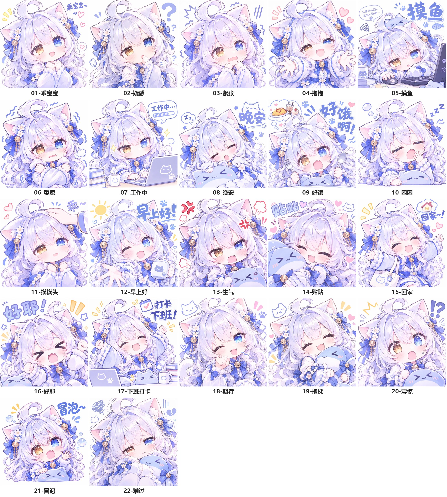

# 蓝白猫娘表情包 · Catgirl Sticker Pack

**著作权人 / Author:** 龚震宇
**版本 / Version:** 1.0.0
**首发日期 / First published:** 2026-11-25
**仓库地址 / Repository:** https://github.com/beizilaoshi/mengmiao-sticker-archive
**许可 / License:** 保留所有权利 · **任何使用均须事先书面授权**（见 [LICENSE](LICENSE)）

一套 22 张的原创表情包，同一角色、同一配色（蓝白），覆盖日常聊天的主要情绪与场景。



---

## 一、内容清单

| # | 文件 | 情绪 / 文案 | SHA-256（前 12 位） |
|---|------|------------|---------------------|
| 01 | `assets/01-乖宝宝.jpg` | 乖宝宝~ | `b90faca50a54` |
| 02 | `assets/02-疑惑.jpg` | 疑惑（?） | `3df70abe873c` |
| 03 | `assets/03-紧张.jpg` | 紧张、冒汗 | `3d1759abc8a9` |
| 04 | `assets/04-抱抱.jpg` | 抱抱、伸手 | `02fc071fa3fb` |
| 05 | `assets/05-摸鱼.jpg` | 摸鱼（在工作） | `60e19b5456c3` |
| 06 | `assets/06-委屈.jpg` | 委屈、发抖 | `ceee0ab7ced5` |
| 07 | `assets/07-工作中.jpg` | 工作中… | `d3e628a8d7d4` |
| 08 | `assets/08-晚安.jpg` | 晚安 | `531e521f5248` |
| 09 | `assets/09-好饿.jpg` | 好饿啊！ | `b6b75a9a64b7` |
| 10 | `assets/10-困困.jpg` | 困（zzz） | `3a4e247b00c1` |
| 11 | `assets/11-摸摸头.jpg` | 乖~（摸头） | `42b19b3fdca` |
| 12 | `assets/12-早上好.jpg` | 早上好！ | `5b1e0c7c8e04` |
| 13 | `assets/13-生气.jpg` | 生气 | `b700365204de` |
| 14 | `assets/14-贴贴.jpg` | 贴贴 | `d10fc75b2487` |
| 15 | `assets/15-回家.jpg` | 回家~ | `1a4e34f71539` |
| 16 | `assets/16-好耶.jpg` | 好耶！ | `f0de2b56a318` |
| 17 | `assets/17-下班打卡.jpg` | 打卡下班！ | `462cbccd8d51` |
| 18 | `assets/18-期待.jpg` | 期待 | `3d9ccc98e312` |
| 19 | `assets/19-抱枕.jpg` | 抱枕、撒娇 | `951f4d67a975` |
| 20 | `assets/20-震惊.jpg` | 震惊（!?） | `58a0d6fc3057` |
| 21 | `assets/21-冒泡.jpg` | 冒泡~ | `f2768709324c` |
| 22 | `assets/22-难过.jpg` | 难过、掉眼泪 | `56d38bd2618e` |

规格：JPEG，1254 × 1254 px，单张约 210–245 KB。
完整的哈希、字节数、原始文件名对照见 [MANIFEST.csv](MANIFEST.csv)，sha256sum 校验文件见 [MANIFEST.sha256](MANIFEST.sha256)。

---

## 二、授权摘要

**本作品采用「全部使用均须授权」原则：除法律强制规定的合理使用外，任何使用都必须事先取得书面授权。**

| 场景 | 是否需要授权 |
|------|--------------|
| 下载、保存到本地 | 📝 需事先书面授权 |
| 在微信/QQ/Telegram 等聊天中当表情发送、转发 | 📝 需事先书面授权 |
| 个人主页、博客、社交平台展示（即使非营利、标了作者） | 📝 需事先书面授权 |
| 做成表情包售卖、周边、壁纸包、印刷品 | 💰 需书面商业授权 |
| 广告、带货、直播引流、企业宣传 | 💰 需书面商业授权 |
| 改色、改画、加字、拼接、抠图重绘 | 🚫 不予授权 |
| 拿去训练 AI 模型或建数据集 | 🚫 不予授权 |
| 去掉署名后重新发布、冒充原创 | 🚫 一律禁止 |
| 以任何方式暗示权利人背书或存在合作 | 🚫 一律禁止 |

**如何申请：** 邮件 `2023351165@qq.com`（标题 `授权申请-<用途>-<申请人>`）或在本仓库提交 Issue，写明身份、联系方式、使用平台与场景、张数、是否商用、期限与地域。个人非商业申请 7 日内答复，商业申请 15 日内答复；**未收到书面同意即视为未获授权**。

完整条款（含授权流程、违约后果与管辖）见 [LICENSE](LICENSE)。

---

## 三、时间戳与权属证据

本仓库同时用四种方式固定「谁、在什么时候、发布了什么」：

1. **Git 提交记录**——每次提交带 SHA-1 与时间，任何改动都会留下不可回填的痕迹；
2. **SHA-256 全量清单**——[MANIFEST.sha256](MANIFEST.sha256)，任何一张图被改动，哈希立刻对不上；
3. **可信时间戳（TSA）**——对 `MANIFEST.sha256` 申请第三方时间戳，司法实践中可直接作为电子证据；
4. **作品登记**——中国版权保护中心美术作品登记，是平台投诉最认的硬材料；
5. **创作过程材料**——生成本组作品所用的提示词原文（[evidence/prompts/](evidence/prompts/)）与逐张记录，见 [CREATION-LOG.md](CREATION-LOG.md)。本组作品由权利人设计提示词、借助 AI 图像生成工具产出初稿后选题定稿，创作方式的完整说明见 [NOTICE.md](NOTICE.md) 第二节。

### 时间线（相互印证）

| 时间 | 事件 |
|------|------|
| 2026-11-06 00:13:52 | 首批 4 张已作为 PNG 原图存在于本人 QQ 记录中（时间戳由 QQ 服务器生成，精确到秒） |
| 2026-11-07 20:39–20:49 | 第二批 4 张 |
| 2026-11-10 19:54–20:19 | 第三批 15 条；20:56 相册收到 1254×1254 / 2.3MB PNG 原图 |
| 2026-11-25 23:08 | 22 张定稿导出为 JPEG |
| 2026-11-25 23:20 | 首次公开发布（本仓库首个提交 `53ee7fe`，tag `v1.0.0`） |
| 2026-11-25 23:57 | **邮件存证**：从 `zhuo0355943@163.com`（共筑社）向 `2023351165@qq.com`（beizi）发送一封 59 MB 邮件，正文即本组作品；两家独立邮件服务器的收件记录，见 [evidence/email/](evidence/email/) |

完整聊天记录长图见 [evidence/README.md](evidence/README.md) 第三节；**精确到秒的 QQ 明文导出记录（23 条，22 条与 `assets/` 逐张对应）见 [evidence/qq-chat/](evidence/qq-chat/)**；提示词原件见 `evidence/prompts/`。**所有聊天时间戳均由 QQ 客户端/服务器生成**。

详细操作步骤见 [TIMESTAMP.md](TIMESTAMP.md)，登记材料清单见 [COPYRIGHT-REGISTRATION.md](COPYRIGHT-REGISTRATION.md)。

---

## 四、发现侵权怎么办

1. 先截图取证：侵权页面 URL、发布时间、发布者 ID、图片本体（用于比对哈希）；
2. 用 [COMPLAINT-TEMPLATES.md](COMPLAINT-TEMPLATES.md) 里的模板向平台提交投诉；
3. 需要走法律程序时，先按 [TIMESTAMP.md](TIMESTAMP.md) 把证据固定下来（时间戳 / 公证）。

---

## 五、目录结构

```
.
├── assets/                  22 张原图（1254×1254）
├── evidence/prompts/         提示词原文（画风 + 角色设定，创作过程证据）
├── evidence/screenshots/     时间线证据（QQ 聊天记录长图、相册信息页）
├── evidence/qq-chat/         QQ 明文导出：23 条图片发送记录（精确到秒）+ 逐张对应表
├── evidence/qq-export/       QQ 加密导出包哈希清单（原件不入库）
├── evidence/email/           邮件存证：2026-11-25 23:57 发出的 59 MB 自寄邮件（PDF + 哈希）
├── evidence/README.md        过程证据索引与时间线
├── preview.jpg              带文件名的预览总览图
├── MANIFEST.csv             逐文件：尺寸 / 字节 / SHA-256 / 原始文件名
├── MANIFEST.sha256          sha256sum 格式校验文件
├── LICENSE                  著作权许可协议（中文为准 + 英文摘要）
├── NOTICE.md                版权声明（权利人、首发时间、禁止事项）
├── CREATION-LOG.md          创作过程记录（举证用）
├── TIMESTAMP.md             时间戳与存证操作指引
├── COPYRIGHT-REGISTRATION.md 作品登记材料清单
├── COMPLAINT-TEMPLATES.md   国内平台投诉模板
├── .gitattributes
└── .gitignore
```

---

## 六、联系与授权

- **任何使用（含非商业）均须事先书面授权**：邮件 `2023351165@qq.com`，或在本仓库提交 Issue；
- 邮件标题格式：`授权申请-<用途>-<申请人>`，正文写明身份、联系方式、使用平台与场景、张数、是否商用、期限与地域；
- 侵权举报请在 Issue 中附截图、页面 URL 与发布时间，或直接邮件联系；
- 完整条款见 [LICENSE](LICENSE)，权利人信息见 [NOTICE.md](NOTICE.md)。

© 2026 龚震宇. 保留所有权利。
